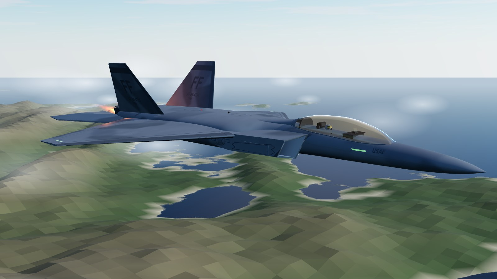
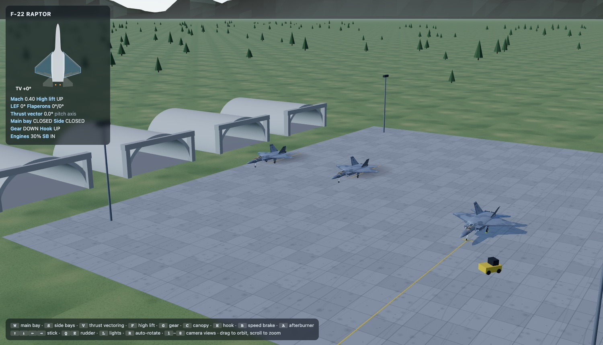
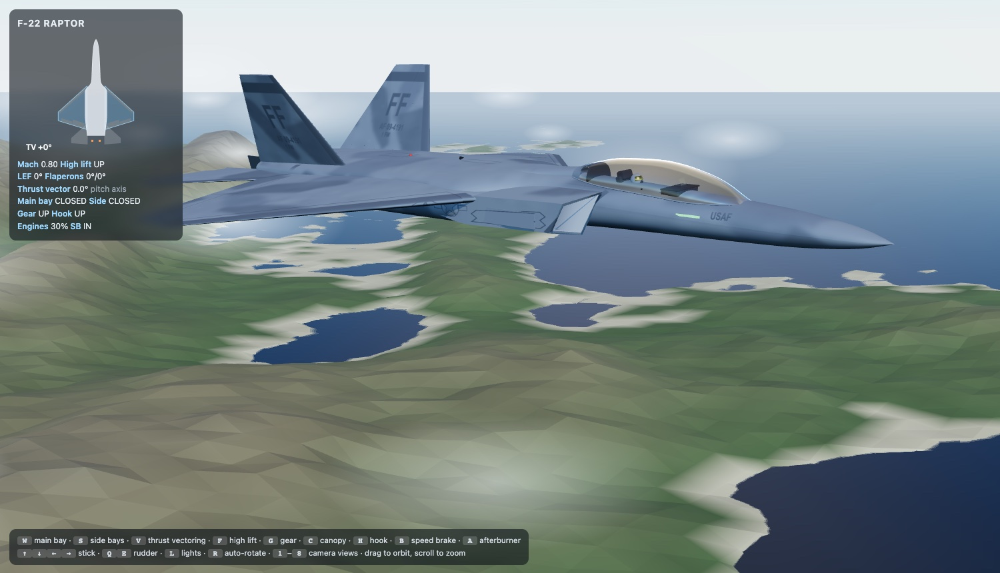
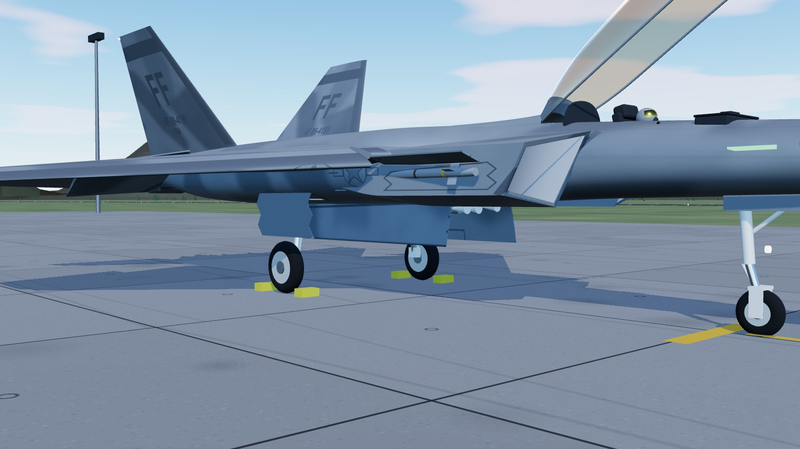
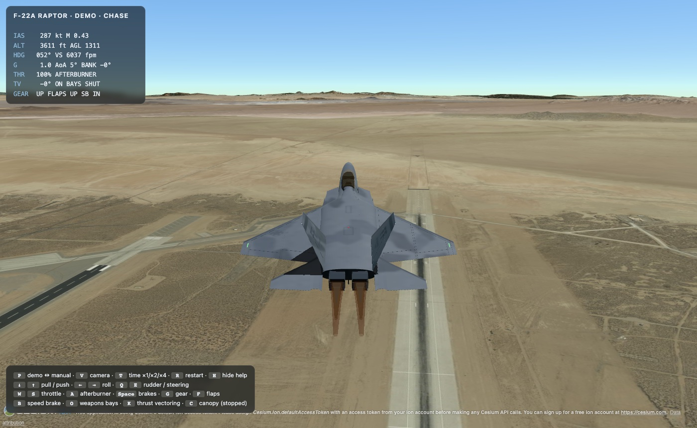
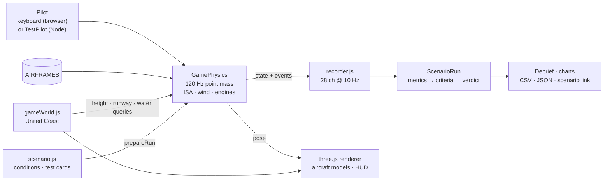
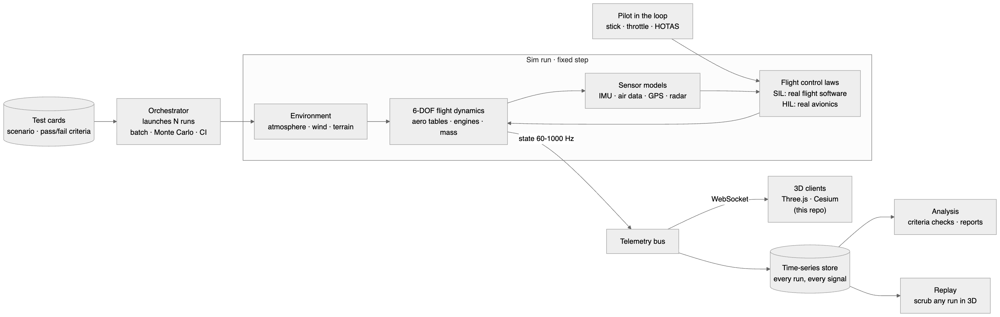

# F-22 Raptor

<p align="center">
  <a href="https://rohit-v-gore.github.io/flight-simulator-gore/"><b>▶ Play it in your browser: rohit-v-gore.github.io/flight-simulator-gore</b></a><br>
  <sub>No install or sign-up. Fly the F-22, Concorde, an airliner or an electric seaglider over United Coast. Needs a desktop browser and a keyboard.</sub>
</p>

A procedural F-22A Raptor for the browser, built in [Three.js](https://threejs.org/): every surface is generated from published dimensions in code, with no 3D model files or image textures. It has working control surfaces, 2D thrust-vectoring nozzles, internal weapons bays and landing gear, a world to sit in, and a CesiumJS page where it flies a demo sortie over Edwards AFB on real terrain.

It is also the visual front end for a planned aerial test and simulation platform (see [System design](#system-design)).



## Play

**Play it now: https://rohit-v-gore.github.io/flight-simulator-gore/** (desktop browser with a keyboard). Or run it locally with `npm run dev` and open **http://localhost:5173**: **United Coast**, a flight test and scenario simulator.

**The map** is a 180 × 120 km continent of eight major US cities, surrounded by ocean. Seattle, San Francisco, Los Angeles, Denver, Dallas, Chicago (on its own Great Lake), New York and Miami each have a skyline, a landmark and an airport. Coastal cities also have a waterfront dock. Mountain ranges run between them. Every runway has markings, approach lights and PAPI glide-slope lights. Buildings are solid.

**Four aircraft**, each with its own flight characteristics:

| Aircraft | Character |
| --- | --- |
| F-22 Raptor | Stealth fighter: 9 G, thrust vectoring, afterburner, about Mach 2.3 |
| Concorde | Supersonic airliner: Mach 2 cruise, reheat for takeoff and transonic acceleration |
| Airliner (A320-class) | Subsonic twinjet: big flaps, Mach 0.78 cruise, Mach 0.9 limit |
| Seaglider | Electric wing-in-ground-effect craft: floats, rises onto a hydrofoil, flies 15–45 ft over water |

**Scenarios:**
- **Tutorial** (start here): step by step, adapted to the aircraft (the seaglider gets a water version).
- **Free flight**: from any runway or dock to any other.
- **Landing challenge**: start on final and get graded on the touchdown.
- **Test card**: a flight test with pass/fail criteria. See [Sim Lab](#sim-lab).

The flight model is fly-by-wire: ↓/↑ ask for G (a centred stick holds the flight path), and ←/→ roll and hold the bank. The HUD shows indicated airspeed (KIAS), ground speed, altitude, Mach, G and vertical speed, and outlines nearby runways.

Touchdowns are graded Butter, Smooth or Firm. Any of these is a crash:
- gear up
- too much sink
- wings not level
- landing in a crab
- touching down nose first
- water (or land, for the seaglider)
- a building

| Key | Action |
| --- | --- |
| `↓` `↑` | Pull / push (G) |
| `←` `→` | Roll |
| `A` `D` | Rudder / nose-wheel steering |
| `W` `S` | Throttle up / down |
| `X` | Afterburner |
| `Space` · `P` | Wheel brakes (hold) · parking brake |
| `G` · `F` / `Shift+F` · `B` | Gear · flaps down / up · speed brake |
| `O` · `K` · `C` | Weapons bays · thrust vectoring · canopy (stopped) |
| `V` · `R` · `H` · `Esc` | Camera (chase / cockpit / orbit) · restart · hide controls · pause |

Other pages: **hangar.html** to inspect the jet and its systems up close, **flight.html** for the CesiumJS demo sortie over real Edwards AFB terrain.

## Sim Lab

The engineering layer, for aircraft programmes (supersonic, electric, seaglider) that need repeatable, reproducible flight scenarios. Full reference: **[docs/SIM_LAB.md](docs/SIM_LAB.md)**.

- **Conditions:** wind (speed, direction, gusts, with a surface layer) and temperature (ISA deviation).
- **Design what-ifs:** mass, thrust, zero-lift drag and CLmax as a percentage of the baseline. Rotation and approach speeds rescale automatically.
- **Failures:** engine (or motor) failures triggered at an airspeed, with asymmetric yaw.
- **Test cards** with pass/fail criteria:
  - takeoff performance
  - engine failure at rotation
  - gusty crosswind landing
  - hot & high departure (Denver, ISA+25)
  - cruise efficiency (fuel or kWh per nm)
  - transonic acceleration, including a sonic-boom check for supersonic time over land
- **Flight data recorder:** 28 channels at 10 Hz, plus an event log (brake release, liftoff, 35 ft screen, engine failure, touchdown, stop) and live performance measurements.
- **Report** after every flight:
  - verdict, criteria and metrics
  - deltas against your previous run of the same scenario
  - altitude, airspeed and G charts
  - downloads: CSV flight data, JSON report, the scenario file, or a shareable link that reproduces the exact scenario
- **Batch runner** for automation, sweeps and CI:

  ```bash
  npm run sim                                                      # every automatable card × aircraft
  npm run sim -- --aircraft airliner --card takeoff --sweep massPct=80:120:10
  npm run sim -- --aircraft seaglider --card cruise --set windKt=15,windFrom=180
  npm run sim -- --scenario my-scenario.json                       # a scenario saved from the game
  ```

  A scripted test pilot flies each card the same way every time. The runner writes `reports/<timestamp>/summary.md`, plus a JSON report and a CSV per run. It exits with code 1 if any run fails, so airframe-data changes can be gated in CI.

Baseline results (standard day, calm):

| Card | F-22 | Concorde | Airliner | Seaglider |
| --- | --- | --- | --- | --- |
| Takeoff distance to 35 ft | 661 m | 1,514 m | 1,205 m | liftoff after 538 m of water |
| Same, Denver ISA+25 | 870 m | 2,065 m | 1,723 m | — |
| Cruise burn | 5.5 kg/nm (M0.9) | 21.5 kg/nm (M2.0) | 5.2 kg/nm (M0.78) | 4.8 kWh/nm (130 kt) |
| Transonic acceleration | M0.95→1.6 in 146 s | M0.95→1.8 in 275 s | — | — |

## What's in it

**The aircraft**
- Chined fuselage, caret intakes with raked lips, a 42° diamond wing with a forward-swept trailing edge, twin tails canted 28°, notched stabilators and a frameless gold-tinted canopy.
- Moving parts: stabilators, ailerons, flaperons, leading-edge flaps, rudders, gear with sawtooth doors, canopy, arresting hook, bay doors and missile launchers.
- **Thrust vectoring:** upper and lower nozzle flaps deflect ±20° together with the stick; they also open in afterburner. The plume follows the nozzle.
- **Weapons bays:** the main bay opens and its launchers push six AIM-120s clear; the side bays swing an AIM-9 out on a trapeze.
- **Control mixing and interlocks:** speed brake as a surface mix (ailerons up, flaperons down, rudders toed out); high lift retracts above Mach 0.6; with weight on wheels the gear handle is locked down.
- Paint: two-tone grey camouflage or plain test-fleet grey, painted procedurally onto a texture atlas and projected onto the airframe.

**The hangar** (hangar.html)
- An air base: runway with markings and edge lights, taxiway, aircraft shelters, control tower, ground vehicles, more parked Raptors, trees and hills.
- In flight: procedural terrain, coastline and clouds that stream past at the jet's speed.

| Air base | In flight |
| --- | --- |
|  |  |



**The flight page** (CesiumJS)
- The same model, exported to glTF at startup, flying a scripted sortie from Edwards AFB runway 04R: afterburner takeoff, a slow high-alpha pass on thrust vectoring, a fast pass with the bays open, then an approach and landing on 22L, and repeat.
- Take over at any time (**P**) and fly it: point-mass flight model with standard atmosphere, afterburner thrust, drag from gear, flaps, speed brake and open bays, ground roll and brakes.



## Run it

Needs Node.js 20.19+ (or 22.12+) and a WebGL 2 browser.

```bash
npm install
npm run dev          # game: http://localhost:5173 · hangar: /hangar.html · globe flight: /flight.html
npm run build        # production build in dist/
npm run deploy       # build and publish dist/ to the gh-pages branch (GitHub Pages)
```

`npm run deploy` publishes the current local code, so commit and push first; the site updates about a minute later.

The flight page loads CesiumJS from a CDN. For your own Cesium ion token (optional), copy `.env.example` to `.env` and fill it in. Flight page options: `?mode=manual`, `?camera=cockpit|flyby|free`, `?livery=ghost`, `?buildings=0`, `?shadows=0`.

### Viewer controls

| Key | Action |
| --- | --- |
| `W` / `S` | Main weapons bay / side bays |
| `V` | Thrust vectoring on/off |
| `F` | High lift: up → takeoff → landing |
| `G` `C` `H` `B` | Gear (locked down on the ground) · canopy · hook · speed brake |
| `A` | Afterburner |
| Arrows · `Q` `E` | Stick · rudder |
| `L` · `R` | Lights · auto-rotate |
| `1`–`8` | Camera views (incl. nozzles and weapons bays close-ups) |

The panel on the right has everything else: Mach, demos (control exerciser, post-stall pitch, bay cycle), paint, ferry tanks, scene, sun and exposure.

### Flight controls

`P` demo/manual · `V` camera · `T` time ×1/×2/×4 · `R` restart · `H` help · `↓`/`↑` pull/push · `←`/`→` roll · `Q`/`E` rudder and nosewheel · `W`/`S` throttle · `A` afterburner · `Space` brakes · `G` gear · `F` flaps · `B` speed brake · `O` bays · `K` thrust vectoring · `C` canopy (stopped).

## System design

**The full write-up is in [docs/SYSTEM_DESIGN.md](docs/SYSTEM_DESIGN.md).** It covers requirements, architecture, the frame loop, the physics step, the Sim Lab data flow and contracts, design trade-offs, extension points and the roadmap.

### How it works today



- **The simulation core runs in two places.** The physics, scenarios, recorder and grading are plain JavaScript with no browser dependencies. The browser game and the `npm run sim` batch runner use the same files, so a scenario flown by hand can be re-run in batch with the same results.
- **Scenarios are data.** A scenario is a small JSON object you can save to a file or share as a `?scenario=` link. Test cards declare a start state, an end condition and pass/fail criteria.
- **Physics is fixed-step.** It runs at 120 Hz behind an accumulator, so results don't depend on the frame rate.
- **The F-22 pages (`hangar.html`, `flight.html`) predate the game.** `src/f22` builds the aircraft, and `F22.js` turns commands into actuator positions with control mixing and interlocks. The hangar viewer renders it directly; the Cesium page exports it to glTF and animates the same parts.
- **Physics is a point-mass model:** it includes standard atmosphere, temperature deviation, wind and gusts, transonic wave drag, ground effect, thrust lapse and ram recovery, and engine failures. It gives credible trends and comparisons, such as how much takeoff distance grows with weight or how energy use changes with drag. It is not certified engineering data.

### Toward an aerial test and simulation platform

<p align="center"></p>

| Layer | What it adds | Notes |
| --- | --- | --- |
| Test cards | Scenarios as data: initial conditions, manoeuvres, disturbances, pass/fail criteria | **Built** (`src/sim/scenario.js`): six cards, conditions, failures, shareable scenarios |
| Orchestrator | Many headless runs, faster than real time: sweeps, Monte Carlo, CI on every change | **Built in part** (`npm run sim`): batch runs and parameter sweeps with a scripted pilot; Monte Carlo is next |
| 6-DOF flight dynamics | Aero tables, engine and mass models on a fixed time step | An open-source FDM such as JSBSim fits here; `flightModel.js` is the placeholder |
| Flight control and sensors | Control laws, actuator limits, IMU / air data / GPS / radar models | Software-in-the-loop runs real flight code; hardware-in-the-loop swaps in real avionics |
| Telemetry | Every signal of every run on a bus and in a time-series store | **Recorded locally** (`src/sim/recorder.js`: 28 channels, CSV); a shared store and live bus are next |
| Analysis and replay | Automatic criteria checks and reports; scrub any run in 3D | **Reports built** (criteria, metrics, charts, run-to-run deltas); 3D replay is next |

Next steps: replace the point-mass model with 6-DOF dynamics and aero tables, feed in real airframe data, put the sim behind a state stream (WebSocket) that the viewers consume, then add 3D replay and Monte Carlo dispersions.

## Project layout

```
index.html, src/game/       United Coast: physics (all four airframes), world (cities, airports, docks), HUD, missions, tutorial
src/aircraft/               the four aircraft models (see CONTRACT.md)
src/sim/                    Sim Lab: scenario.js (conditions, test cards, grading), recorder.js (flight data), testPilot.js
scripts/sim-run.mjs         headless batch runner (npm run sim)
hangar.html, src/main.js    hangar viewer: scene, light, panel, HUD, keyboard, demos
src/world/world.js          air base, flight terrain, clouds
src/f22/
  F22.js                    assembly, commands → actuators, control mixing, interlocks
  dims.js                   reference geometry (wing, tails, gear, nozzles)
  body.js · wing.js · tail.js · engine.js · bays.js · gear.js · cockpit.js
  geom.js · util.js         lofting, sections, hinges, interpolation
  livery.js · materials.js  paint atlas and the projection shader
flight.html, src/flight/
  main.js                   Cesium viewer, model sync, cameras, HUD, keys
  flightModel.js            point-mass flight model (120 Hz)
  autopilot.js              runway geometry and the demo sortie
  exportModel.js            Three.js → GLB with the paint baked to UVs
docs/                       screenshots and diagrams (Mermaid sources included)
```

`window.__f22` in the viewer exposes the jet, scene and camera for console tinkering.

## Notes

This is a visual model, not a certified simulator. Dimensions follow published F-22 figures (length 18.92 m, span 13.56 m, height 5.08 m); many details are simplified for real-time rendering. The flight model's numbers are F-22-class estimates, not manufacturer data.

## License

[MIT](LICENSE) © Rohit Gore
