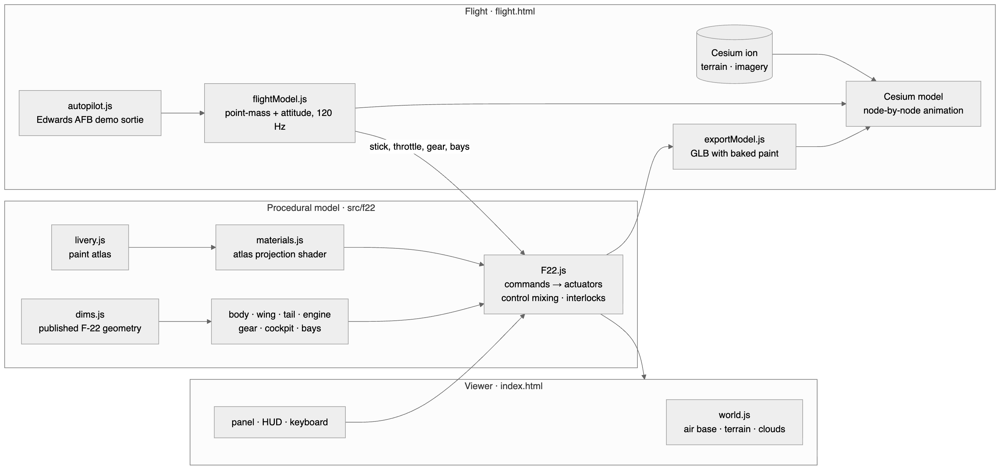

# F-22 Raptor

A procedural F-22A Raptor for the browser, built in [Three.js](https://threejs.org/): every surface is generated from published dimensions in code, with no 3D model files or image textures. It has working control surfaces, 2D thrust-vectoring nozzles, internal weapons bays and landing gear, a world to sit in, and a CesiumJS page where it flies a demo sortie over Edwards AFB on real terrain.

It is also the visual front end for a planned aerial test and simulation platform (see [System design](#system-design)).


## What's in it

**The aircraft**
- Chined fuselage, caret intakes with raked lips, a 42° diamond wing with a forward-swept trailing edge, twin tails canted 28°, notched stabilators and a frameless gold-tinted canopy.
- Moving parts: stabilators, ailerons, flaperons, leading-edge flaps, rudders, gear with sawtooth doors, canopy, arresting hook, bay doors and missile launchers.
- **Thrust vectoring:** upper and lower nozzle flaps deflect ±20° together with the stick; they also open in afterburner. The plume follows the nozzle.
- **Weapons bays:** the main bay opens and its launchers push six AIM-120s clear; the side bays swing an AIM-9 out on a trapeze.
- **Control mixing and interlocks:** speed brake as a surface mix (ailerons up, flaperons down, rudders toed out); high lift retracts above Mach 0.6; with weight on wheels the gear handle is locked down.
- Paint: two-tone grey camouflage or plain test-fleet grey, painted procedurally onto a texture atlas and projected onto the airframe.

**The world** (viewer)
- An air base: runway with markings and edge lights, taxiway, aircraft shelters, control tower, ground vehicles, more parked Raptors, trees and hills.
- In flight: procedural terrain, coastline and clouds that stream past at the jet's speed.

| Air base | In flight |
| --- | --- |
|  |  |


**The flight page** (CesiumJS)
- The same model, exported to glTF at startup, flying a scripted sortie from Edwards AFB runway 04R: afterburner takeoff, a slow high-alpha pass on thrust vectoring, a fast pass with the bays open, then an approach and landing on 22L, and repeat.
- Take over at any time (**P**) and fly it: point-mass flight model with standard atmosphere, afterburner thrust, drag from gear, flaps, speed brake and open bays, ground roll and brakes.


## Run it

Needs Node.js 20.19+ (or 22.12+) and a WebGL 2 browser.

```bash
npm install
npm run dev          # viewer: http://localhost:5173  ·  flight: http://localhost:5173/flight.html
npm run build        # production build in dist/
```

The flight page loads CesiumJS from a CDN. For your own Cesium ion token (optional), copy `.env.example` to `.env` and fill it in. Flight page options: `?mode=manual`, `?camera=cockpit|flyby|free`, `?livery=ghost`, `?buildings=0`, `?shadows=0`.

### Viewer controls

| Key | Action |
| --- | --- |
| `W` / `S` | Main weapons bay / side bays |
| `V` | Thrust vectoring on/off |
| `F` | High lift: up → takeoff → landing |
| `G` `C` `H` `B` | Gear (locked down on the ground) · canopy · hook · speed brake |
| `A` | Afterburner |
| Arrows · `Q` `E` | Stick · rudder |
| `L` · `R` | Lights · auto-rotate |
| `1`–`8` | Camera views (incl. nozzles and weapons bays close-ups) |

The panel on the right has everything else: Mach, demos (control exerciser, post-stall pitch, bay cycle), paint, ferry tanks, scene, sun and exposure.

### Flight controls

`P` demo/manual · `V` camera · `T` time ×1/×2/×4 · `R` restart · `H` help · `↓`/`↑` pull/push · `←`/`→` roll · `Q`/`E` rudder and nosewheel · `W`/`S` throttle · `A` afterburner · `Space` brakes · `G` gear · `F` flaps · `B` speed brake · `O` bays · `K` thrust vectoring · `C` canopy (stopped).

## System design

### How it works today

<p align="center"></p>

- **One model, two front ends.** `src/f22` builds the aircraft; `F22.js` turns commands (stick, throttle, switches) into actuator positions at realistic rates, with control mixing and interlocks. The viewer renders it directly; the flight page exports it to glTF and animates the same parts.
- **Physics is deliberately simple today**: a point-mass model good for demos and driving the visuals, not for engineering answers.

### Toward an aerial test and simulation platform

<p align="center"></p>

| Layer | What it adds | Notes |
| --- | --- | --- |
| Test cards | Scenarios as data: initial conditions, manoeuvres, disturbances, pass/fail criteria | Versioned with the code so results are reproducible |
| Orchestrator | Many headless runs, faster than real time: sweeps, Monte Carlo, CI on every change | The same scenario runs in batch or with a pilot in the loop |
| 6-DOF flight dynamics | Aero tables, engine and mass models on a fixed time step | An open-source FDM such as JSBSim fits here; `flightModel.js` is the placeholder |
| Flight control and sensors | Control laws, actuator limits, IMU / air data / GPS / radar models | Software-in-the-loop runs real flight code; hardware-in-the-loop swaps in real avionics |
| Telemetry | Every signal of every run on a bus and in a time-series store | The 3D views become subscribers, so live view and replay share one stream |
| Analysis and replay | Automatic criteria checks and reports; scrub any run in 3D | The HUDs already render state; they need a data source instead of a local sim |

First steps: put the sim behind a state stream (WebSocket) that the viewers consume; replace the point-mass model with 6-DOF dynamics; define a test-card format and a headless runner; then record runs and add replay.

## Project layout

```
index.html, src/main.js     viewer: scene, light, panel, HUD, keyboard, demos
src/world/world.js          air base, flight terrain, clouds
src/f22/
  F22.js                    assembly, commands → actuators, control mixing, interlocks
  dims.js                   reference geometry (wing, tails, gear, nozzles)
  body.js · wing.js · tail.js · engine.js · bays.js · gear.js · cockpit.js
  geom.js · util.js         lofting, sections, hinges, interpolation
  livery.js · materials.js  paint atlas and the projection shader
flight.html, src/flight/
  main.js                   Cesium viewer, model sync, cameras, HUD, keys
  flightModel.js            point-mass flight model (120 Hz)
  autopilot.js              runway geometry and the demo sortie
  exportModel.js            Three.js → GLB with the paint baked to UVs
docs/                       screenshots and diagrams (Mermaid sources included)
```

`window.__f22` in the viewer exposes the jet, scene and camera for console tinkering.

## Notes

This is a visual model, not a certified simulator. Dimensions follow published F-22 figures (length 18.92 m, span 13.56 m, height 5.08 m); many details are simplified for real-time rendering. The flight model's numbers are F-22-class estimates, not manufacturer data.

## License

[MIT](LICENSE) © Rohit Gore
