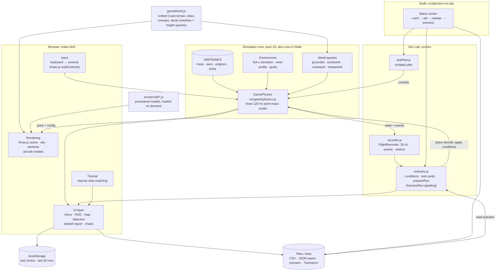
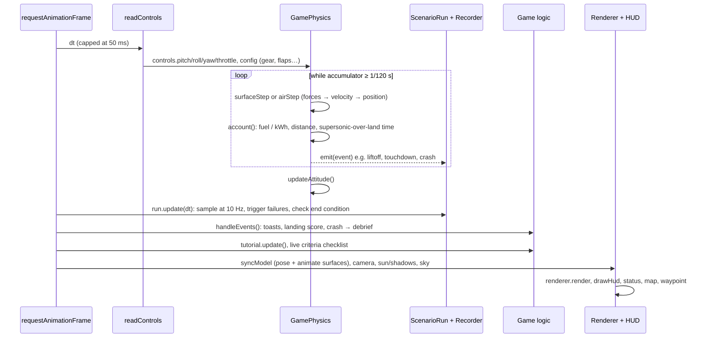
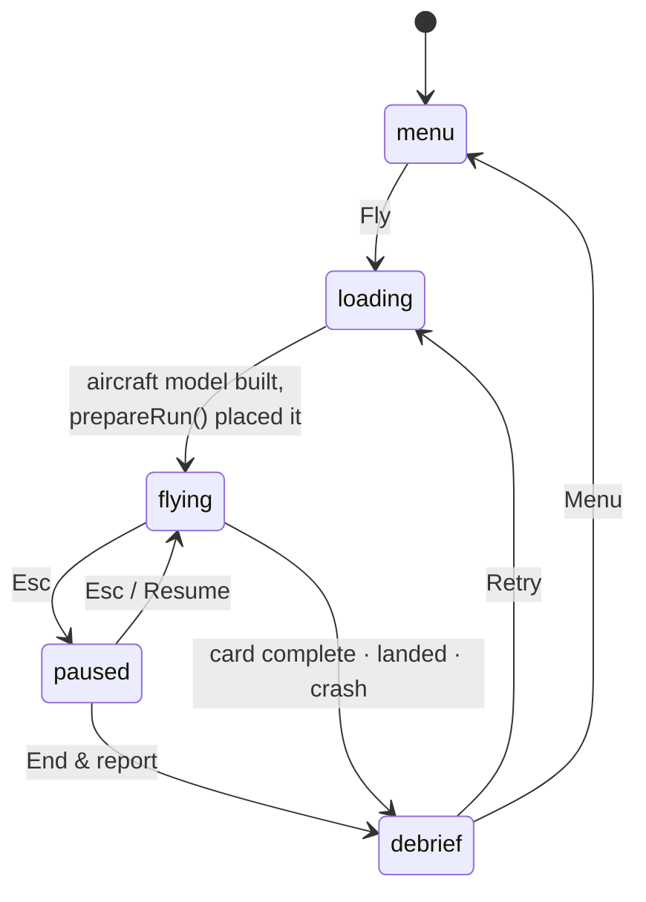
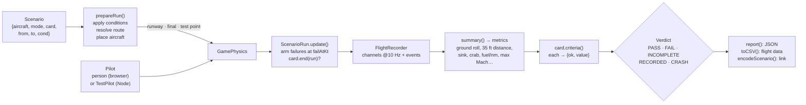
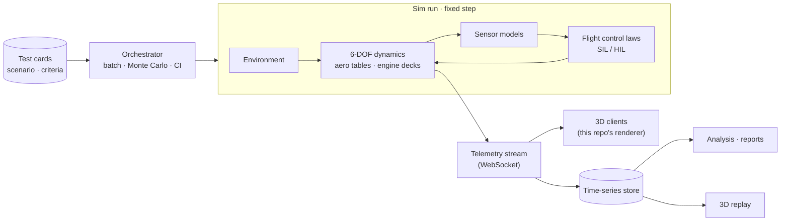

# System design: Flight Simulator Gore

How the game and the Sim Lab are built from start to finish: what each part does, how data moves between the parts, why it was built this way, and what comes next.

- **What it is:** a browser flight simulator set on a made-up map, United Coast: eight US-style cities, airports, seaplane docks and open water.
- **Aircraft:** four types, flown with one shared physics engine: the F-22, Concorde, an A320-class airliner, and an electric seaglider.
- **Two kinds of use:**
  - **A game:** free flight, landing challenges and a tutorial.
  - **A test tool (Sim Lab):** repeatable test cards with pass/fail grading, a flight data recorder, reports, and a batch runner that works without a browser.

---

## 1. Requirements that shaped the design

| Requirement | What it led to |
| --- | --- |
| Runs in any modern browser with no install, no server and no account | A static site (Vite + three.js); all state lives on the device |
| A flight flown by hand can be re-run automatically with the same results | The physics, scenario and grading code is plain JavaScript with no browser APIs, so the same files run in the game and in Node |
| Engineers can change conditions without touching code | Scenarios are data (`{aircraft, mode, card, from, to, cond}`) that can be saved as JSON or shared in a link |
| Results are numbers, not impressions | A flight data recorder (28 channels at 10 Hz), metrics computed from it, criteria checked against them, and CSV/JSON export |
| Adding an aircraft must not mean touching the physics or the game loop | A model contract (`src/aircraft/CONTRACT.md`) plus a data table (`AIRFRAMES`) |
| Saving a file must never throw a pilot out of a flight | Hot reload is turned off (`server.hmr: false`) |

---

## 2. Architecture



The key boundary is the **simulation core and Sim Lab** (centre). They don't depend on the DOM, the renderer or the clock, and take time as `dt` passed in. The browser is one driver: a person at the keyboard and `requestAnimationFrame`. The Node batch runner is another: the scripted pilot and a fixed loop. Both produce the same reports.

### Modules

| Module | Responsibility | Depends on |
| --- | --- | --- |
| `src/game/main.js` | Wires everything together: input, cameras, HUD, menu, missions, report screen, charts, downloads, history, the frame loop | everything below |
| `src/game/physics.js` | `GamePhysics`, the flight model; `AIRFRAMES`; atmosphere; `airframeWith()` overrides | `three` (vectors only), a `world` object |
| `src/game/gameWorld.js` | United Coast: terrain heights, coastline and channels, cities, airports, runways, PAPI lights, docks, obstacles; builds the meshes | `three` |
| `src/game/tutorial.js` | Step lists for the runway and water tutorials | the context passed in |
| `src/aircraft/*.js` | One procedural 3D model per aircraft, following `CONTRACT.md` | `three` |
| `src/sim/scenario.js` | Conditions, routes, start states (runway, final approach, test point), test cards, `ScenarioRun`, scenario encoding | physics, recorder |
| `src/sim/recorder.js` | Samples channels, captures events, computes metrics, exports CSV | physics |
| `src/sim/testPilot.js` | A closed-loop scripted pilot for automated cards | physics |
| `scripts/sim-run.mjs` | Command-line orchestration, sweeps, report files, exit code | sim + physics + world queries |

---

## 3. How one frame runs

Rendering runs at the display's frame rate. Physics runs at a **fixed 120 Hz** inside it, using an accumulator, so the results don't depend on the frame rate. A 30 fps laptop and a 144 Hz monitor fly the same flight.



**Events have two consumers.** Physics pushes events into an array, which the game drains for toasts and scoring. It also calls listeners directly through `physics.emit()`, which is how the recorder gets them. An early version only had the array, so the game ate events before the recorder saw them. The listener pattern fixed that.

### Game states



---

## 4. The physics model

`GamePhysics.step(dt)` advances a **point mass with attitude** (wind axes). It isn't full 6-DOF; the fly-by-wire style handling sets pitch rate, roll rate and load factor directly from the stick, within each airframe's limits.

**Each 1/120 s substep:**

1. **Atmosphere.**
   - Density and speed of sound come from the International Standard Atmosphere, shifted by `isaDevC`.
   - Wind follows a power-law surface layer, `(h/10 m)^0.14`, plus smooth gusts of several frequencies.
   - The aircraft flies on **air-relative velocity**: `airVel = vel − wind`.
2. **Airspeeds.**
   - `tas` is true airspeed.
   - `ias` is equivalent airspeed, `tas·√(ρ/ρ₀)`. The HUD, rotation speed and control authority use it.
   - Mach, propeller power and energy use `tas`.
3. **Lift and drag.**
   - Lift comes from CL, limited to CLmax for each flap setting.
   - Drag is `CD0` (flaps, gear and speed brake add to it), plus induced drag, plus transonic wave drag.
   - Ground effect cuts induced drag.
4. **Thrust.**
   - Dry and reheat thrust, lapsed with density.
   - Ram recovery at high Mach (`ram`).
   - The seaglider's thrust is limited by power (`thrustPower / V`).
   - Failed engines reduce thrust and add a yawing moment.
5. **On the ground or water** (`surfaceStep`): rolling friction and brakes, nosewheel steering, rotation at Vr, and buoyancy and planing for the seaglider.
6. **In the air** (`airStep`):
   - Integrate forces.
   - Check for terrain and obstacle collisions.
   - At touchdown, classify sink rate and crab angle, and flag a crash if limits are exceeded.
7. **Accounting:**
   - Fuel from TSFC × thrust, or battery energy from thrust·TAS / drive efficiency.
   - Distance flown.
   - Time spent supersonic over land (sonic-boom exposure).

The physics never reaches out for data. Every lookup it makes about the world (ground height, runway, water) goes through a small `world` object passed in at construction. That is why the batch runner can give it the same height functions without building any 3D meshes.

**Airframes are data.** `AIRFRAMES` holds each type's mass, wing area, CL and CD build-up, thrust, TSFC, Vr/Vapp, G limits and touchdown limits. Test conditions scale them through `airframeWith(type, {massPct, thrustPct, dragPct, clMaxPct})`, which also re-derives Vr and Vapp as √(mass/CLmax).

---

## 5. Sim Lab: from scenario to verdict



### Data contracts

These shapes stay stable, so anything outside the game can depend on them.

**Scenario.** Small enough to fit in a URL as base64url JSON:
```json
{ "aircraft": "airliner", "mode": "test", "card": "takeoff", "from": null, "to": null,
  "cond": { "windKt": 10, "windFrom": 160, "gustKt": 0, "isaDevC": 25,
            "massPct": 110, "thrustPct": 100, "dragPct": 100, "clMaxPct": 100,
            "failEngines": 0, "failAtKt": 0 } }
```

**Test card.** Code, but declarative:
```js
{ id, name, aircraft: [...], summary, pilot, manual?,
  start: 'departure' | 'final' | 'test-point', point(id)?,
  conditions(ac, ctx)?, band(ac, id)?,
  end(run) → boolean,
  criteria(ac, ctx) → [{ label, test(metrics, recorder, run) → { ok, value } }] }
```

**Report:** `{ scenario, result: {verdict, reason}, criteria[], metrics{}, events[], channels[] }`, and the CSV has one column per channel.

### One engine, two drivers

| | Browser | Batch runner (Node) |
| --- | --- | --- |
| Clock | `requestAnimationFrame`, real time | Fixed `dt = 1/60` loop, as fast as the CPU allows |
| Pilot | Person at the keyboard | `TestPilot`: heading hold, rotate at Vr, climb-path hold, altitude and speed hold |
| World | `buildGameWorld()` meshes + height queries | Height queries only (no WebGL) |
| Output | Debrief screen, charts, deltas against the previous run, downloads | `summary.md`, `summary.json`, a JSON + CSV per run, exit code 1 on any non-PASS |
| Use | Pilot-in-the-loop evaluation, demos | Regression checks, parameter sweeps, CI gating |

All 17 automated card × aircraft runs pass on the current data, and the batch takes a few seconds. That makes it a usable regression test: change an airframe number, run `npm run sim`, and see which cards it breaks.

---

## 6. Rendering and content

- **Procedural models, no binary assets.**
  - Every aircraft is built from code (lofted sections, hinged control surfaces, animated gear), so the repo is small and fully readable.
  - Models load on demand with `import()`, and each follows `CONTRACT.md`: origin at the gear contact point, +X forward, plus an `update(dt, state)` that animates surfaces from the physics state.
- **A made-up world, no map licensing.**
  - United Coast is generated: terrain from noise, coastline by distance from the shore, dredged channels, city blocks, airports with runways and PAPI lights, and seaplane docks.
  - The renderer and the physics read the same height functions, so what you see is what you hit.
- **Real-time budget.**
  - One shadow-casting sun that follows the aircraft.
  - A sky dome that moves with the camera.
  - Models under about 250k triangles.
  - The production build is about 1 MB of JavaScript.

---

## 7. Design decisions and trade-offs

| Decision | Why | Cost |
| --- | --- | --- |
| Point-mass model rather than 6-DOF | Fast, stable at 120 Hz, easy to tune four very different airframes, credible trends | Not engineering-grade, and handling doesn't come from aero derivatives |
| Pure-JS core shared by browser and Node | One source of truth: a scenario flown by hand can be re-run in batch with the same results | `main.js` has to stay out of the core, which is a discipline to keep up |
| Scenarios as data, cards as declarative objects | Non-programmers can change conditions; links and files are portable | Criteria are still JS functions, not a no-code rule editor |
| Fixed-step physics with an accumulator | The same results at any frame rate | Up to one substep of lag between physics and rendering |
| Event listeners alongside the event queue | The recorder and the game both see every event | Two delivery paths to keep in sync |
| Indicated airspeed (EAS) on the HUD and for rotation | Matches real cockpits; a hot-day takeoff behaves correctly | Two airspeeds to explain to newcomers |
| localStorage for history | No backend, works offline, private | History stays in one browser, with no sharing or leaderboards |
| Procedural art and a made-up world | No licensing risk, a small repo, everything is code | More code to write than importing a model |
| Hot reload off | A saved file never resets a flight | You refresh by hand to see changes |

---

## 8. Ways to extend it

| To add | Touch | Then |
| --- | --- | --- |
| An aircraft | `AIRFRAMES` in `physics.js`, a model in `src/aircraft/`, the `AIRCRAFT` registry in `main.js` | Every card that lists it works in the game and in batch |
| A test card | `TEST_CARDS` in `scenario.js` | Appears in the menu, the live checklist and `npm run sim` |
| A condition | `CONDITION_FIELDS` + `applyConditions` in `scenario.js` | Appears in the menu form, scenario links and `--set` / `--sweep` |
| A recorder channel or metric | `CHANNELS` / `summary()` in `recorder.js`, plus `METRICS` in `main.js` for display | Appears in the CSV, the JSON and the report |
| A map | Replace `gameWorld.js` behind the same query functions | Physics and Sim Lab work unchanged |

---

## 9. What's missing, and the path forward

### Getting it to players and contributors

| Gap | Plan |
| --- | --- |
| Not hosted | A GitHub Actions workflow builds `dist/` and deploys to GitHub Pages on every push; `base: './'` already supports any path |
| Keyboard only | Touch controls (virtual stick and throttle) and the Gamepad API, both feeding the same `controls` object |
| No automatic checks | CI that runs `npm run build` and `npm run sim` on every pull request; the runner's exit code already gates it |
| Hard to start contributing | `CONTRIBUTING.md`, a pinned Node version, splitting `main.js` into `hud/`, `menu/`, `report/` and `camera/` modules |
| Leftover F-22 naming and pages | Rename the package and folders; move the older `hangar`, `flight` and `preview` pages under `tools/` |

### Toward an engineering platform



| Layer | Status today |
| --- | --- |
| Test cards and scenarios | **Built**: six cards, ten conditions, failures, shareable scenarios |
| Orchestrator | **Partly built**: batch runs and sweeps; Monte Carlo and parallel workers are next |
| Flight dynamics | Point-mass now; swap in a 6-DOF engine (such as JSBSim) behind the same `step(dt)` and state interface |
| Sensors and flight control | Not started; software-in-the-loop would run real control code against the model |
| Telemetry | **Recorded locally** (28 channels); a live stream and a shared store are next |
| Analysis and replay | **Reports built** (criteria, metrics, charts, run-to-run deltas); 3D replay of a recorded CSV is next |

The layers are separated so each one can be upgraded on its own. Replacing the physics doesn't touch scenarios, grading or the renderer. Replacing the renderer doesn't touch the physics. Moving the sim to a server only means the browser reads state from a stream instead of from `GamePhysics`.

---

## 10. Other pages in the repo

The F-22 work that came before the game is still in the repo:
- `hangar.html` is a detailed F-22 viewer with animated systems.
- `flight.html` flies the F-22 over a CesiumJS globe with a demo autopilot.
- `aircraft-preview.html?model=<id>` previews any model on its own.

These pages share the `src/f22` model code but not the game's physics or Sim Lab.
